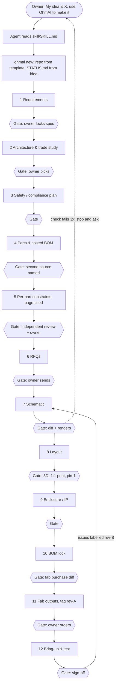
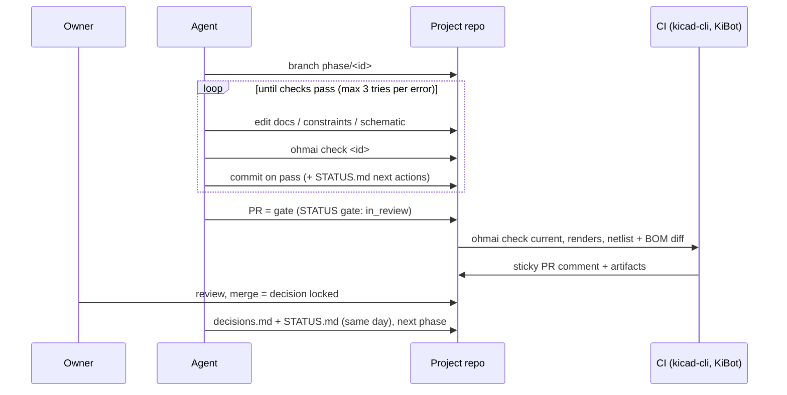
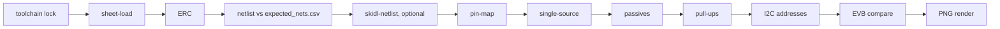

<!-- SPDX-License-Identifier: Apache-2.0 -->
<!-- Copyright 2026 The OhmAI contributors -->
# Architecture

OhmAI has three parts: a **skill** that tells an agent how to run a hardware project, a **template** that
every project starts from, and a **CLI** (`ohmai`) that does the checks an LLM must not be trusted to do in
its head.

## Flow inside a phase

## Artifacts are the interface

| Artifact (in the project repo) | Written in | Read by |
|--------------------------------|------------|---------|
| `STATUS.md` (front matter: phase, gate; locked decisions; open questions) | every phase | agents, `ohmai status`, CI |
| `docs/requirements.md`, `architecture.md`, `safety.md`, `enclosure.md` | 1, 2, 3, 9 | later phases, `docs:` checks |
| `docs/manual.md` (user instructions) | 3 (draft), 12 (final) | `manual-warnings`, `manual` checks |
| `docs/decisions.md` (append-only log) | every gate | everyone |
| `parts/selection.md`, `bom/bom.csv` | 4, 10 | `bom-schema`, `bom-lock`, `bom-diff` |
| `parts/constraints/<PART>.yaml` (+ `constraints.schema.json`) | 5 | `constraints`, `pin-map`, `single-source`, `passives`, `pullups`, `i2c-addr`, `evb-compare` |
| `rfq/*.md` | 6 | `rfq` (standalone check), owner |
| `expected_nets.csv` | 7 (before drawing) | `netlist`, `skidl-netlist` |
| `toolchain.lock.yaml` (`ohmai lock`; moved only by `ohmai upgrade`) | 7 (first), any upgrade | `toolchain`, `kicad-app`, `kicad-libs` |
| `hardware/*.kicad_*` | 7, 8 | kicad-cli checks, KiBot |
| `test/bringup-plan.md`, GitHub issues | 12 | rev-B |

## `ohmai check` pipeline (schematic phase)

- **sheet-load** runs first because a sheet that fails to parse is silently dropped from ERC, which then
  reports "0 violations". It exports a netlist per sheet and also catches missing sheet files.
- **ERC/DRC** call `kicad-cli ... --format json --severity-all`. Errors and warnings both fail. Allowing
  warnings is an owner decision (`ohmai.yaml`).
- **toolchain** first: installed KiCad, libraries and helper tools must equal `toolchain.lock.yaml`
  (tier 1 exact, tier 2 ranges), so every later result is reproducible.
- **netlist** compares the kicadsexpr netlist with `expected_nets.csv` (missing, split, merged, extra,
  name, NC). **skidl-netlist** (optional) checks the same intent a second way: SKiDL builds a netlist from
  `expected_nets.csv` with the pinned KiCad symbols and it is compared with the export as net partitions.
- **constraint checks** match netlist parts to constraints files (by `MPN` field, value, or library symbol)
  and apply the per-pin rules.
- Outputs go to `out/` (gitignored) with `summary.md` / `summary.json` for CI comments.

## Git strategy

| | Tool repo (this one) | Project repo (generated) |
|-|----------------------|--------------------------|
| `main` | always releasable | approved, locked state only |
| Work | short `feat/` `fix/` branches + PR, green CI | `phase/<id>`, `fix/<name>`; commit after each check pass |
| Review | PR | PR = gate; CI posts renders, netlist and BOM diffs; merge = decision locked |
| Tags | semver `vX.Y.Z` | `rev-A`, `rev-B` + GitHub release (gerbers, BOM, PnP) |
| Version link | n/a | `ohmai.yaml` records the OhmAI version; `.ohmai/phases/` pinned; `ohmai upgrade-guides` re-pins |
| Binaries | none | datasheets via Git LFS; generated outputs only in releases |
| Feedback | issues | bring-up findings as issues (label `rev-B`) |

## Licensing boundary
Core (skill, template, CLI) is Apache-2.0, and its Python dependencies are permissive (pinned in
`cli/constraints.txt`). GPL/AGPL code runs only as a separate process or CI step, never imported or vendored:

| Tool | License | How OhmAI runs it |
|---|---|---|
| KiCad (`kicad-cli` / pcbnew) | GPL-3.0 | subprocess; external system install |
| Freerouting | GPL-3.0 | separate Java process (DSN/SES files); `ohmai setup` downloads the pinned jar (2.2+ needs Java 25) |
| easyeda2kicad | AGPL-3.0 | subprocess only; `ohmai setup` installs it automatically, not shipped; downloads follow EasyEDA's terms |
| KiBot | AGPL-3.0 | CI step (its GitHub action / container) |
| SKiDL | MIT, but imports InSpice (GPL-3.0-or-later) at import time | `ohmai/_skidl_runner.py` in a subprocess (`$OHMAI_SKIDL_PYTHON`) |

MIT tools that ohmai reads files from (jlcparts database, InteractiveHtmlBom through KiBot) need no boundary,
but they are still optional and locked.

## Research tools: what OhmAI uses, in which phase, and why
Source: `docs/research.md` (2026-10-14). Every tool used is a **tier-1 entry** in the
project's `toolchain.lock.yaml`, so its version is exact and moves only through `ohmai upgrade`.

| Tool | Phase | Status in OhmAI | Why |
|---|---|---|---|
| kicad-cli | 7, 8, 11 | used: sheet-load, ERC, DRC, netlist, render, fab exports, golden builds | the only headless, stable KiCad surface |
| Official KiCad libraries | 7, 8 | used: pinned tag, per-project lib tables | reproducible symbols/footprints |
| SKiDL | 7 | used (optional): `skidl-netlist`, separate process | independent second netlist from the design intent; validates pin numbers against the real symbols |
| jlcparts | 4 | used (optional): `ohmai parts search` on a local DB | offline parametric candidates; the snapshot is locked, live values still come from the page |
| KiBot | 11 | used: template CI release outputs (gerbers, BOM, PnP, iBoM, PDFs, STEP) | mature YAML outputs; AGPL, so CI only |
| InteractiveHtmlBom | 11 | used through KiBot's `ibom` output | assembly aid |
| KiKit | 11 | locked; not invoked yet (roadmap v0.4: panels, fab presets) | MIT, scriptable; wait for the first panelized board |
| Freerouting | 8 | locked (jar sha256 + Java runtime version); optional for non-critical nets (phase 8 guide); no ohmai command yet; run headless, analytics/telemetry off, no network (no switch for its start-up version check up to 2.2.4) | GPL, separate process; critical nets stay hand-routed |
| kicad-python (kipy) | 8 | locked; not invoked yet (roadmap: placement helpers over the IPC API) | the IPC API needs a running KiCad and covers the board editor first |
| KiAuto | – | not used directly | superseded by kicad-cli; KiBot may use it inside its container |
| Nexar/Octopart, JLCPCB API | 4 | not used yet (roadmap v0.4 sourcing adapters) | need accounts/keys; must report source + date |

Not used, on purpose:
- **atopile** compiles its own `.ato` language to a KiCad PCB and picks parts automatically. OhmAI's
  source of truth is a KiCad schematic a human reviews (drawn from layout YAML like a datasheet figure),
  and parts are chosen by the owner with a named second source and page-cited constraints. Automatic part
  picking and a second design language would bypass both gates.
- **tscircuit** is a TypeScript/React ecosystem with its own IDE and reaches KiCad only through
  converters. It would add a Node toolchain and a lossy conversion between the design and the checks.
- **KiCad MCP servers** (mixelpixx, lamaalrajih, Seeed and others) are, per the research, fragmented
  prototypes with partial schematic support. They edit boards directly without OhmAI's gates and are not
  version-locked. OhmAI works through files plus the `ohmai` CLI, which any agent can call. A thin MCP
  wrapper over `ohmai` itself stays a roadmap item (v0.6+), not a third-party server.
- **Commercial tools** (JITX, Flux, Circuit Mind, CELUS, Quilter, DeepPCB) are not open, and a design
  cannot be uploaded without an owner decision. A placement/routing adapter could be an opt-in later.

## Testing the tool itself
See `docs/TESTING.md`. In short: the **known-bad** suite plants one mistake per check and requires FAIL
on it and PASS on a clean twin; **golden** projects rebuild from sources and must match approved
snapshots; `ohmai upgrade` runs both before a tier-1 pin moves; the weekly **canary** runs both against the
newest KiCad and libraries and only reports.

## External converter licensing
`easyeda2kicad` is AGPL-3.0, not MIT. Invoke it only as a separate optional subprocess; never import or bundle it in the agent plugin. KiCad/pcbnew, Freerouting, EasyEDA/LCSC CAD data, KiBot and SKiDL/InSpice remain external tools/data, with their own licenses and terms. The native pcbnew refill lives in the `_REFILL` script string in `layout/native_guard.py` and is executed only by a separate Python process. It is not imported into the Apache CLI process.

The separate `_skidl_runner.py` executable imports SKiDL only in its own interpreter. Core modules must not import the runner, SKiDL/InSpice or pcbnew; package validation checks these direct-import boundaries. Neither runner nor the CLI is included in the guidance-only plugin.
