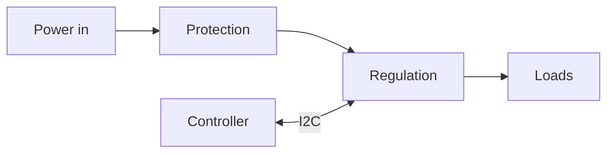

<!-- ohmai:template: fill in, then delete this line. Gate: the owner picks an option (phase 2). -->
# Architecture: {{project_name}}

## Block diagram

## Options compared
| Criterion (from requirements) | Option A | Option B | Option C |
|-------------------------------|----------|----------|----------|
| Meets all musts? | | | |
| Efficiency / losses | | | |
| BOM cost (ESTIMATE, qty) | | | |
| Part count / board area | | | |
| Risk (new parts, layout difficulty) | | | |
| Sourcing (second source?) | | | |

Recommendation: _agent writes one, with reasons_. **Owner decision:** _D-xxx in decisions.md_.

## Power tree and budget
| Rail | Source | V nom (min..max) | I typ / max | Load(s) | Loss (W) | Source of numbers |
|------|--------|------------------|-------------|---------|----------|-------------------|

## Bus map
| Bus | Controller | Device | Address / CS | Speed | Pull-ups (where, value) | Voltage domain |
|-----|------------|--------|--------------|-------|-------------------------|----------------|

## Thermal
| Part | Loss (W) | θJA or board estimate | ΔT | Tj at max ambient | Margin to Tj max | Source |
|------|----------|-----------------------|----|-------------------|------------------|--------|

## Sheets (one block per schematic sheet)
| Sheet | Block | Main parts |
|-------|-------|------------|
